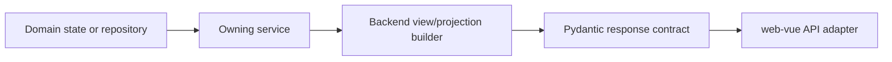

# Backend Map

Status: current

The Go deployment entry is `cmd/control-server` under `go-backend`, with separate
schema-only initialization and a loopback authenticated settings health probe.
`Dockerfile.go`, the dedicated Compose manifest and `deploy/go-ops.sh` assemble
and operate it without changing API routes or domain persistence ownership.
The [release runbook](../runbooks/go-release.md) owns those commands and limits.

The backend exposes stable JSON projections and action results. It does not
render product HTML or transfer browser interaction ownership to Python.

## Entry points

The independent Go prototype starts at
[`go-backend/cmd/upstream-probe`](../../go-backend/cmd/upstream-probe/main.go).
It is a CLI upstream client. The independent stage-2 HTTP entry point is
[`cmd/control-server`](../../go-backend/cmd/control-server/main.go), documented
in [the control-plane guide](../go-control-plane.md). It registers 39 management
method/path pairs against an explicit rehearsal Application Database, plus 12
public/task/asset routes when an explicit isolated data directory is supplied.
See [the public-execution guide](../go-public-execution.md). Python
remains the production owner; no automatic routing change occurs. See
[the prototype guide](../go-upstream-prototype.md) and
[complete compatibility inventory](../go-api-compatibility.md).
The Go upstream Client owns Sentinel proof/Turnstile evaluation, SSE decoding
and single-image discovery. Its `image-poll` mode resumes a known conversation
with GET requests, without creating another generation or durable Image Task.

[`../../api/app.py`](../../api/app.py) assembles five routers:

| Router | Primary surface | Principal owners |
| --- | --- | --- |
| [`api/ai.py`](../../api/ai.py) | OpenAI-compatible text, search, image, Messages, Responses, and editable-file endpoints | Protocol services, `LoggedCall`, `EditableFileTaskService` |
| [`api/accounts.py`](../../api/accounts.py) | User Keys, Upstream Accounts, Account Groups, account operations, OAuth, CPA, and Sub2API | `AuthService`, `AccountService`, import services |
| [`api/image_tasks.py`](../../api/image_tasks.py) | Studio-owned asynchronous image task endpoints | `ImageTaskService` |
| [`api/prompts.py`](../../api/prompts.py) | Prompt Library reads and Prompt Source refresh/mutation | `PromptLibraryService` |
| [`api/system.py`](../../api/system.py) | Login, version/update, settings, gallery, logs, monitor, proxy, dashboard, backup, and storage operations | Corresponding domain services and view builders |

Routers authenticate, validate transport contracts, translate expected domain
errors to HTTP responses, and call an owning service. They must not become a
second implementation of service state transitions.

### Model catalog and image compatibility

`ModelCatalogService` defaults chat models to `gpt-5.6` and `auto` and retains
explicit configured overrides. The console and `/v1/models` consume the same
catalog; listing models does not query upstream or append upstream-only entries.

`utils.helper.WEB_IMAGE_MODELS` owns the built-in Web image identifiers:
`gpt-image-2`, `gpt-image-2.5`, `gpt-image-2.5-flare`, and
`gpt-image-2.5-sunburst`. Model validation and `ModelCatalogService` consume this
list; Studio consumes the backend catalog. Explicit catalog configuration still
takes precedence over the built-in list. No `exact` aliases are added.

The 2.5 identifiers use the existing `auto` upstream Web model slug. They are
compatibility names and do not force a particular official API image engine or
quality entitlement. Existing `gpt-image-2` and Codex routing and the default
image model remain unchanged.

## Go rehearsal ownership

| Go Module | Responsibility |
| --- | --- |
| `internal/repository` | Compatible control-plane and Call Record tables, collection CAS, SQLite writer serialization and PostgreSQL row/advisory locks |
| `internal/controlplane/auth.go` | Bearer/bootstrap identity, SHA256 User Keys, rotation, revocation and bounded cache staleness |
| `internal/controlplane/settings.go` | Effective settings, metadata, revisioned nested patches and secret masking |
| `internal/controlplane/proxy*.go` | Proxy Reference CRUD/imports, assignment checks, precedence and image-egress leases |
| `internal/controlplane/account*.go`, `maintenance.go`, `pool.go` | Stable account identity, projections, local mutations, credential rotation/sync, bounded maintenance and admission leases |
| `internal/controlplane/operations.go`, `http*.go`, `server.go` | Ephemeral progress, request validation, HTTP projections, aliases and downloads |
| `internal/upstream/maintenance.go`, `proxy_probe.go` | Native RT exchange, account metadata calls and fixed-origin proxy probes |

The optional execution layer adds the following native owners. Stage 4 extends
them with [remaining operations](../go-remaining-operations.md) under
[ADR 0008](../adr/0008-go-remaining-domain-repositories-and-operations.md),
including FlareSolverr clearance and complete management registration.

| Stage-3 Go Module | Responsibility |
| --- | --- |
| `public_*.go` | Public protocol validation, normalization, errors, token usage and bounded streaming/cache |
| `text_cache.go` | Optional Redis successful-text event cache, bounded atomic expiry/capacity and fail-open reads/writes; local in-flight deduplication remains in `public_text.go` |
| `image_execution.go`, `image_inputs.go`, `image_transform.go` | Shared image execution, masks, account attempts, deadlines and input limits |
| `image_tasks*.go`, `internal/filepersist` | Durable task lifecycle, projections, queue, spooling and compatible locks/JSON |
| `image_assets.go` | Registered asset save/read and compatible local/WebDAV catalog commits |
| `call_records.go`, `internal/repository/call_records.go` | Independent final Call Record append, with existing SQL payload/derived columns |
| `internal/upstream/{image*,assets,search}.go` | Native uploads, multimodal text, image tools, search, safe downloads and read-only polling |

Stage-4 native owners additionally include `RemoteImports`/`OAuthLogin`,
`ProxyClearance`, `EditableTasks`, `PromptLibrary`, `RealtimeMonitor`,
`Dashboard`, `BackupService`, `Retention` and `GoUpdater`. Their independent SQL,
file and process-memory boundaries mirror the domain table below. Call Record
queries own log projections; dashboard checkpointing coordinates serial commits
before advancing its cursor. Gallery remains one `ImageAssets` owner. Background
maintenance and managed Go updates require explicit opt-in.

Image execution evidence stays in the existing Account Pool (`pool.go`): stable
account IDs and actual routes share a bounded ten-minute success preference or
terminal tool-failure cooldown. `upstream.WebImageRoute` owns alias normalization.
Metadata refresh, credential rotation and public protocol adapters do not own a
second capability table. Structured tool errors and poll deadlines are parsed in
the native upstream owner, and known-conversation recovery never regenerates.
Configured image polling reads the current conversation before diagnostic tasks.
Committed pointers skip task probes while pending/task-only results retain their
failure and settling rules. Fixed-name duration callbacks feed the existing
RealtimeMonitor without moving its stage clock or introducing durable state.
Call Record monitor metrics separate polling network/sleep/settle time from
asset resolution, download and local publication; no transport payload is traced.

Read-only task recovery carries the optional task-owned `upstream_account_id`
through a private execution context. `Accounts.AcquireImagePoll` owns the bound
account/image-egress lease and current credentials, including quota-exhausted
accounts; it cannot select a substitute. The native executor resolves missing
legacy references only from owner/conversation-scoped Call Records and fails
closed on ambiguity. The final Call Recorder consumes originating identity
before stream projection removes internal fields. See [ADR 0010](../adr/0010-bind-image-recovery-to-origin-account.md).

## Domain and persistence ownership

| Domain | Owning Module | Stable Interface/output | Persistence |
| --- | --- | --- | --- |
| Upstream Accounts and User Keys | `AccountService`, `AuthService` | Account/auth projections and batch action results | Account Repository through `DatabaseStorageBackend` |
| Settings and policy | `SettingsManagementService`, runtime configuration | Effective settings projection and mutation result | `SystemSettingsRepository` |
| Proxy routing | `ProxyManagementService`, `ProxyService` | Proxy References, groups, tests, and runtime view | `ProxyConfigurationRepository` |
| Call Records | `LoggedCall`, `CallRecordService` | Call summary/detail projections | `CallRecordRepository` |
| Active Requests and live operations | `RealtimeMonitorService` | Snapshot and call-detail records | Process memory |
| Dashboard Metric Projection | `DashboardMetricsService` | 24-hour cards and 24h / 7d / 30d chart snapshots from one hourly projection | `DashboardMetricsRepository` with state, hourly, and per-model hourly tables |
| Runtime environment | `runtime_environment_service` | One runtime snapshot | No durable state |
| Image Tasks | `ImageTaskService` | Owner-scoped task projection and terminal result | `data/image_tasks.json` |
| Image Assets and gallery | `ImageStorageService` | Asset mutation, catalogue, storage, and public URL behavior | Local/WebDAV assets plus `data/image_index.json` |
| Editable File Tasks and Assets | `EditableFileTaskService` | Owner-scoped task commands and public asset resolution | `EditableFileTaskRepository` plus filesystem assets |
| Prompt Sources and Prompt Library | `PromptLibraryService` | Revisioned merged library and source health | `PromptLibraryRepository` |
| CPA/Sub2API imports | `CPAImportService`, `Sub2APIImportService`, `RemoteImportJobCoordinator`, `RemoteAccountImportJob` | One import-job lifecycle and final batch result | Remote-import configuration repository plus Account Repository |
| Online update | `UpdateStatusService`, `UpdateService` | Availability projection and update-task lifecycle | GitHub Release metadata, managed runtime directory, `data/update_task.json` |

The repositories share the engine created by
[`../../services/application_database.py`](../../services/application_database.py)
but retain separate domain interfaces and transaction ownership.

## Projection boundary

- A projection resolves precedence between persisted state, credentials, and
  runtime outcomes before returning final labels, tones, capabilities, and
  allowed actions.
- Contract models validate that output. Vue consumes it and owns presentation;
  it does not recompute the business decision.
- A command result represents the completed action or accepted asynchronous
  task. Polling and retry ownership must be explicit for asynchronous work.

## Shared infrastructure

| Module | Role | Boundary |
| --- | --- | --- |
| `services/application_database.py` | Resolves SQLite/PostgreSQL and owns shared SQLAlchemy engines | Infrastructure only; it does not merge repositories |
| `services/storage/factory.py` | Constructs the Account Repository adapter | It is not a global storage switch |
| `services/storage/file_lock.py` | Coordinates file-backed mutations | Used only by file-backed owners |
| `services/bounded_task_runner.py` and account-processing modules | Bound process work | Their capacity is not image-generation concurrency |
| `api/*_contract.py` | Stable transport validation | Contracts do not own domain state transitions |

Use [`critical-flows.md`](critical-flows.md) when a change crosses these
boundaries; use CodeGraph only to discover additional callers and verify them
against source.
