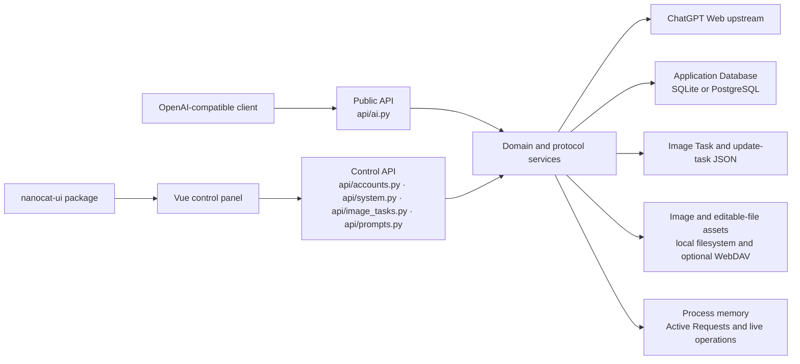

# System Map

Status: current

This map describes the current system boundaries. Domain terms and ownership are
defined by [`../../CONTEXT.md`](../../CONTEXT.md); this document only maps those
terms to the current code.

## Runtime context

[`../../api/app.py`](../../api/app.py) assembles the backend routers. The Vue
router in [`../../web-vue/src/router/routes.ts`](../../web-vue/src/router/routes.ts)
assembles the browser routes.

The separate [`go-backend`](../../go-backend/go.mod) module contains a CLI
upstream probe and an independently invoked Go control-plane rehearsal server.
[ADR 0006](../adr/0006-go-control-plane-rehearsal.md) extends
[ADR 0005](../adr/0005-isolate-go-prototype-and-preserve-contracts.md) with explicit
Application Database access for accounts, User Keys, settings, account groups
and proxy configuration. It does not change production routing or introduce
another persistence owner. The [control-plane guide](../go-control-plane.md)
records its native route coverage, verification and remaining stages.
[ADR 0007](../adr/0007-go-public-execution-and-file-task-ownership.md) and the
[public-execution guide](../go-public-execution.md) extend rehearsal with native
public protocols, durable file-backed tasks/assets and independent final SQL
Call Records, enabled only by an explicit isolated data directory.
[ADR 0008](../adr/0008-go-remaining-domain-repositories-and-operations.md) and the
[remaining-operations guide](../go-remaining-operations.md) complete native
management, imports, gallery/files, observability, backup/cleanup and local Go
update packaging while preserving those independent owners. No production
traffic or scheduler cutover is implied.

The explicit `Dockerfile.go` and `docker-compose.go.yml` assemble that native
server with the unchanged Vue build, PostgreSQL 18 and disposable Redis text
cache. `deploy/go-entrypoint.sh` owns container startup and refuses incomplete
restores; `deploy/go-ops.sh` owns quiesced operational backup, empty-target
restore and image rollback. `.github/workflows/go-verify.yml` owns clean-source
verification/downloadable build artifacts, reused by the tag-gated release
workflow. See the [release runbook](../runbooks/go-release.md).

[ADR 0009](../adr/0009-optional-shared-text-cache.md) adds an explicitly configured
Redis adapter for disposable successful public text responses. PostgreSQL remains
the structured domain store; image task/catalog files and process-local worker
ownership do not move to Redis. See the [live-verification guide](../go-live-verification.md).

## Authority boundaries

| Concern | Authoritative owner | Consumers |
| --- | --- | --- |
| Domain language and relationships | [`../../CONTEXT.md`](../../CONTEXT.md) | Backend, frontend, current docs, and PRDs |
| Business state, capability, diagnostics, and action results | Backend domain services and projection services | API contracts and Vue adapters |
| Public request/response shape | FastAPI contracts under `api/` | External clients and `web-vue/src/api/` |
| Drafts, selection, loading, overlays, layout, and scrolling | The owning Vue page or page-private runtime | Page components |
| Generic controls, overlays, tokens, and interaction primitives | `nanocat-ui` | Vue product pages |
| Product navigation, charts, workflows, and responsive composition | `chatgpt2api/web-vue` | Control-panel users |

The backend does not own browser layout, and the frontend does not reconstruct
backend business meaning from raw fields or error text.

## Persistence boundaries

| State | Current store | Owner |
| --- | --- | --- |
| Upstream Accounts and User Keys | Application Database | Account Repository through `DatabaseStorageBackend` |
| Settings, Proxy Groups, Account Groups, remote-import configuration, Call Records, dashboard aggregates, Prompt Library snapshots, coordination state, and Editable File Tasks | Separate repositories in the Application Database | Their domain services and repository interfaces |
| Image Tasks | `data/image_tasks.json` | `ImageTaskService` |
| Image Assets and gallery catalogue | Local files and optional WebDAV plus `data/image_index.json` | `ImageStorageService` |
| Editable File Assets | Published and staging filesystem directories | `EditableFileTaskService` |
| Active Requests and live operation counters | Process memory | `RealtimeMonitorService` |
| Online-update task progress | `data/update_task.json` | `UpdateService` |
| Studio conversation presentation state | Browser-local storage | Studio conversation runtimes |

One physical Application Database does not create one generic repository or one
transaction boundary. Image Assets, Image Tasks, gallery files, and live
monitoring remain outside it, as accepted by
[`../adr/0004-use-one-application-database-with-domain-repositories.md`](../adr/0004-use-one-application-database-with-domain-repositories.md).

## Detailed maps

- [`backend-map.md`](backend-map.md): router, service, repository, and projection ownership
- [`frontend-map.md`](frontend-map.md): routes, page runtimes, API adapters, and UI boundaries
- [`critical-flows.md`](critical-flows.md): account import, image tasks, observability, dashboard, and online update
